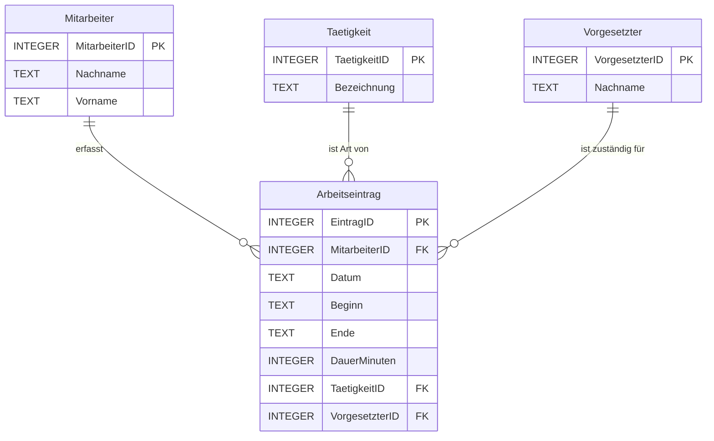

# Datenbankmodell

## Ausgangslage (Excel)

| Datum | Tätigkeit | Arbeitszeit | Zeit (h) | Vorgesetzter |
|---|---|---|---|---|
| 01.09.2024 | Scripterstellung | 8-12:00 | 4:00 | Hansen |

Dazu im Kopf der Datei: **Name** (B3) und **Vorname** (B4).

Probleme der Excel-Struktur:

- **Arbeitszeit nicht atomar.** `13:00 - 16:30` enthält zwei Werte (Beginn und Ende) → Verstoß gegen die 1NF.
- **Schreibweise uneinheitlich.** `8-12:00`, `13:00 - 16:30`, `15:00-13:00` (vertauscht).
- **Spalte „Zeit (h)" unzuverlässig.** Beispiel: `13:00 - 16:30` mit `0:30` statt `3:30`.
- **Wiederholungen.** Mitarbeitername, Tätigkeiten und Vorgesetzte stehen in jeder Zeile bzw. Datei erneut.

## Entscheidungen

1. **Arbeitszeit aufgeteilt** in `Beginn` und `Ende` → atomare Werte, 1NF erfüllt.
2. **Dauer selbst berechnet** (`Ende - Beginn`) und als `DauerMinuten` (Ganzzahl) gespeichert. Die Excel-Spalte „Zeit (h)" wird ignoriert. Minuten als Ganzzahl lassen sich mit `SUM` und `MAX` direkt auswerten.
3. **Stammdaten ausgelagert** in eigene Tabellen (Mitarbeiter, Tätigkeit, Vorgesetzter). Jeder Name steht nur einmal in der Datenbank, Tippfehler-Varianten fallen sofort auf.
4. **Datum im ISO-Format** `JJJJ-MM-TT` → richtig sortierbar als Text, Standardformat für SQLite.
5. **Doubletten** über eine `UNIQUE`-Regel auf alle fachlichen Spalten von `Arbeitseintrag`. Beim Einfügen sorgt `INSERT OR IGNORE` dafür, dass ein vorhandener Datensatz nicht noch einmal geschrieben wird. Das wirkt innerhalb einer Datei, zwischen Dateien und bei erneutem Import.

## ER-Modell



Kardinalitäten: Ein Mitarbeiter hat beliebig viele Arbeitseinträge (1:n). Gleiches gilt für Tätigkeit und Vorgesetzter.

## Relationenschema

- **Mitarbeiter** (<u>MitarbeiterID</u>, Nachname, Vorname)
- **Taetigkeit** (<u>TaetigkeitID</u>, Bezeichnung)
- **Vorgesetzter** (<u>VorgesetzterID</u>, Nachname)
- **Arbeitseintrag** (<u>EintragID</u>, ↑MitarbeiterID, Datum, Beginn, Ende, DauerMinuten, ↑TaetigkeitID, ↑VorgesetzterID)

## Prüfung 1NF

| Kriterium | Erfüllt durch |
|---|---|
| Jedes Attribut atomar | Arbeitszeit in Beginn/Ende getrennt, Name/Vorname getrennt |
| Keine Wiederholungsgruppen | Jede Tätigkeit ist ein eigener Datensatz in `Arbeitseintrag` |
| Eindeutiger Schlüssel je Zeile | Primärschlüssel `EintragID`, fachlich eindeutig durch `UNIQUE` |

Hinweis: `DauerMinuten` lässt sich aus `Beginn` und `Ende` berechnen und ist damit streng genommen redundant. Bewusste Entscheidung zugunsten einfacher Auswertungen. Alternative ohne Spalte in SQLite:

```sql
(strftime('%s', Ende) - strftime('%s', Beginn)) / 60
```
